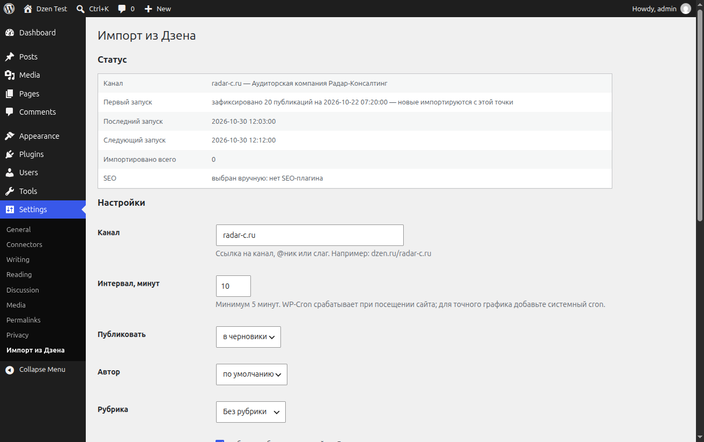

# Dzen Importer

Плагин WordPress, который переносит новые публикации из канала Дзен на ваш сайт: полный текст,
картинки в медиатеку, обложка в миниатюру, оригинальная дата, человеческий слаг и SEO-поля
(для Yoast, Rank Math, AIOSEO, SEOPress, Slim SEO или свои мета-теги).

Сделан для канала [radar-c.ru](https://dzen.ru/radar-c.ru), но работает с любым публичным каналом Дзена.



## Как это работает

У Дзена нет публичного RSS, а страницы отдаются JavaScript-заглушкой. Плагин использует две вещи,
которые Дзен отдаёт обычным HTTP-запросом:

1. **JSON-фид канала** — `dzen.ru/api/v3/launcher/export?channel_name=<канал>`. Отдаёт по 20 публикаций
   (заголовок, анонс, обложка, дата, ссылка) и листается вглубь. Фид открыт без авторизации.
2. **SSR-страница статьи** — Дзен отдаёт полный HTML только поисковым краулерам по User-Agent,
   поэтому плагин запрашивает статью с UA Googlebot. Текст, подзаголовки, списки, цитаты и картинки
   берутся из `itemprop="articleBody"`.

> ⚠️ Второй пункт — не официальный API. Дзен может закрыть доступ краулерам в любой момент,
> и импорт остановится. Плагин в этом случае не падает: пишет ошибку в лог и показывает её в админке.

## Возможности

- Мастер настройки при первом запуске: канал, интервал, статус публикации, автор, рубрика,
  ссылка на источник, SEO-плагин.
- Фиксация текущего состояния канала: при первом запуске ничего не импортируется, только запоминается
  точка отсчёта. Дальше импортируются только новые публикации.
- Ручная догрузка архива порциями («Догрузить старые»).
- Картинки скачиваются в медиатеку, обложка ставится миниатюрой, alt — из статьи или заголовка.
- Дедупликация по ID публикации: повторный запуск не создаёт дублей.
- Лог последних 300 событий и статус в админке.
- WP-CLI: `wp dzen status`, `wp dzen sync`, `wp dzen backfill --limit=20`.
- Видео и шортсы: по умолчанию встраивается плеер Дзена (ничего не хранится у вас), либо, по выбору,
  ролик скачивается в медиатеку с настройкой качества и лимита размера.

## Установка

1. Скачайте архив плагина или склонируйте репозиторий в `wp-content/plugins/dzen-importer`.
2. Активируйте плагин.
3. Откроется «Настройки → Импорт из Дзена». Укажите канал, например `https://dzen.ru/chanel`.
4. Нажмите «Проверить канал», затем «Сохранить настройки».
5. Нажмите «Синхронизировать сейчас» — это зафиксирует текущие публикации канала.
6. Дальше плагин сам проверяет канал раз в N минут (по умолчанию 10).

Для точного расписания на сайте без трафика добавьте системный cron:

```
*/10 * * * * cd /path/to/site && wp cron event run dzen_importer_run --quiet
```

или классический вариант:

```
*/10 * * * * curl -s https://example.com/wp-cron.php?doing_wp_cron > /dev/null
```

## SEO

В настройках можно выбрать плагин вручную или оставить «определить автоматически».

| Плагин | Что записывается |
|---|---|
| Yoast SEO | `_yoast_wpseo_title`, `_yoast_wpseo_metadesc`, `_yoast_wpseo_focuskw` |
| Rank Math | `rank_math_title`, `rank_math_description`, `rank_math_focus_keyword` |
| All in One SEO | `_aioseo_title`, `_aioseo_description` |
| SEOPress | `_seopress_titles_title`, `_seopress_titles_desc` |
| Slim SEO | мета `slim_seo` |
| нет плагина | плагин сам выводит `meta description` и Open Graph теги |

## Разработка

```bash
composer install
composer test          # unit-тесты (без WordPress)

docker compose up -d   # WordPress + MariaDB на http://localhost:18080
docker compose run --rm wpcli wp core install --url=http://localhost:18080 \
  --title="Dzen Test" --admin_user=admin --admin_password=admin \
  --admin_email=admin@example.com --skip-email
docker compose run --rm wpcli wp plugin activate dzen-importer
docker compose run --rm wpcli wp eval-file wp-content/plugins/dzen-importer/tests/integration/run.php
```

Интеграционный тест ходит в реальный Дзен: фиксирует канал, импортирует статью и проверяет
текст, картинки, миниатюру, слаг, дату, SEO-поля и отсутствие дублей.

## Ограничения

- Импортируйте только свой контент или контент, на который у вас есть права.
- Видео, шортсы и комментарии не переносятся.
- Разметка статьи может измениться на стороне Дзена — тогда потребуется обновить парсер.

## Лицензия

GPL-2.0-or-later.
